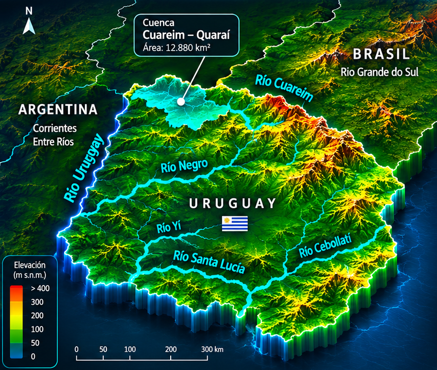

<div align="center">

# 🌎 AQUA·NEXUS 3D

### Earth System Trend Exploration & Flood Visualization

**NASA Space Apps Challenge 2026 · Team Astronomicon**  
**Challenge: Be An Earth System Trend Detective!**

[](https://github.com/YiamRodriguezDelgado/AQUA-NEXUS-3D)


**Explore precipitation. Investigate environmental change. Understand flood-related scenarios.**

[Explore the code](https://github.com/YiamRodriguezDelgado/AQUA-NEXUS-3D) · [NASA POWER](https://power.larc.nasa.gov/) · [NASA GIBS](https://gibs.earthdata.nasa.gov/)

</div>

---

## 🌧️ The challenge

Flooding can disrupt communities and infrastructure in Uruguay. To understand the environmental conditions associated with these events, people need accessible ways to examine historical precipitation and distinguish observed changes from hypothetical scenarios.

**Our research question:** How can NASA Earth science data help people explore precipitation variability across locations and time in Uruguay, and provide context for flood-related risk?

AQUA·NEXUS 3D addresses this question through an interactive exploratory dashboard. **The current prototype does not establish statistically significant long-term trends or validated flood forecasts.** Those are priorities for future research.

## 🛰️ What AQUA·NEXUS 3D does

| Feature | Current implementation | Important distinction |
|---|---|---|
| Interactive Uruguay map | 3D-style artistic terrain and selected areas | Not a georeferenced flood-extent map |
| NASA POWER precipitation | On-demand historical daily `PRECTOTCORR` requests, aggregated by month for Artigas, Salto and Paysandú | Point-based gridded precipitation; requires internet |
| Temporal exploration | Monthly playback, charts and scenario indicators | Some values are synthetic |
| Flood visualization | Illustrative red flood areas and estimated area/volume | Not satellite-detected inundation |
| Experimental projections | Regression-based demonstration for 2026–2027 | Not validated operational forecasts |
| Historical context | References to SINAE's 2015–2016 flood reports | Displacement counts are not flood-area measurements |
| Bilingual interface | English / Español | Geographic proper names remain in Spanish |

## 🗺️ Preview



*Conceptual visualization created for the prototype. This image is artistic and must not be interpreted as a satellite-derived or georeferenced flood map.*

> **Demo suggestion:** Record a short screen capture showing the English-language interface, NASA POWER query, precipitation chart and scenario playback. A local server address such as `127.0.0.1` is **not** publicly accessible to judges.

## 🔬 Data sources and method

### NASA POWER — observed precipitation

The local Python server includes an endpoint (`/api/nasa/historical`) that requests daily NASA POWER `PRECTOTCORR` data for approximate city coordinates and aggregates valid values into monthly totals. Its configured historical interval is **2018–2025**.

- Artigas: approximately **30.40° S, 56.47° W**
- Salto: approximately **31.39° S, 57.96° W**
- Paysandú: approximately **32.32° S, 58.08° W**

These are representative **points**, not precipitation averages for entire river basins. Data are queried on demand and are not embedded in the repository as a verified historical dataset.

### NASA GIBS — imagery discovery

The server contains functionality to discover NASA GIBS WMS precipitation-related layers. **Availability of a layer does not mean that this prototype has extracted or validated flood polygons from satellite imagery.**

### Uruguay SINAE — historical context

The interface references public reporting about the December 2015–January 2016 floods. Counts of displaced people provide event context; they cannot be treated as measured inundated area.

### Experimental analysis

The prototype contains regression and scenario-exploration components. Some historical training examples and future rainfall inputs are synthetic. The current system **does not** demonstrate a validated statistical trend-significance analysis or reliable prediction accuracy. Results must be interpreted as exploratory demonstrations.

## 💻 Requirements

| Item | Requirement |
|---|---|
| Operating system | Windows 10/11 recommended for the included launcher |
| Python | Python 3.10+ recommended; the server uses the Python standard library |
| Browser | Recent Chrome, Edge or Firefox |
| Internet | Required for live NASA data and remote imagery requests |
| Additional Python packages | None required by `server.py` |

## 🚀 Install and run

**Option A — GitHub ZIP**

1. Click **Code → Download ZIP** on this repository and extract it.
2. Install [Python](https://www.python.org/downloads/) if needed. On Windows, enable **Add Python to PATH**.
3. Open the extracted project directory (the one containing `server.py`).
4. Double-click **`INICIAR_AQUA_NEXUS.bat`**.
5. Open **http://127.0.0.1:8711/** in your browser. If the terminal displays a different address, use that address.

**Option B — Git**

```bash
 git clone https://github.com/YiamRodriguezDelgado/AQUA-NEXUS-3D.git
 cd AQUA-NEXUS-3D
 python server.py
```

Then open the local address displayed by the server. The launcher uses port **8711** for v4.1.

**Language:** Use the **EN / ES** selector at the top of the interface. River, city and basin proper names are intentionally preserved.

## 🧭 Suggested demonstration for judges

1. Open the dashboard in **English** and introduce the study area: Uruguay.
2. Identify the conceptual map and explain that red inundation overlays are **illustrative**.
3. Query NASA POWER historical precipitation for a supported location.
4. Explain the difference between **observed precipitation** and **synthetic flood scenarios**.
5. Show the historical-event context and describe the proposed next step: validated trend detection and satellite-derived flood mapping.

## ⚠️ Scientific integrity and limitations

- **Not an early-warning service:** Do not use this prototype for emergency decisions.
- **Not a satellite flood map:** The background is conceptual artwork and the red overlays are simulated.
- **Not validated forecasting:** Regression outputs are experimental and do not establish forecast skill.
- **Not yet a completed trend-significance study:** Long-term trends, significance testing, independent validation and uncertainty quantification require additional verified data and analysis.
- **Observed vs. synthetic:** NASA POWER observations are queried separately from demonstration values.

## 🛠️ Technology

`Python` · `http.server` · `urllib` · `HTML` · `CSS` · `JavaScript` · `NASA POWER API` · `NASA GIBS WMS`

The application runs as a local web server and uses a browser-based interface. No external Python package installation is required for the current server.

## 🔭 Roadmap

- [ ] Compute precipitation trend magnitude and statistical significance from verified long-term series.
- [ ] Add georeferenced maps and reproducible spatial analysis.
- [ ] Compare satellite imagery before and after a documented flood.
- [ ] Validate inundation estimates against independent observed flood extents.
- [ ] Add uncertainty intervals and documented model evaluation.
- [ ] Publish a short demonstration video and reproducible scientific methodology.

## 👩‍🚀 Team Astronomicon

| Member | Role |
|---|---|
| **Yiam Oswaldo Rodríguez Delgado** | Team owner |
| **Francisco Liguori** | Team member |
| **Francisco Faguaga** | Team member |
| **Ciro Poy Vazquez** | Team member |

**Local event:** Punta del Este, Uruguay  
**Competition:** NASA Space Apps Challenge 2026  
**Selected challenge:** Be An Earth System Trend Detective!

*Roles beyond team ownership are not specified here; they can be added once confirmed by the team.*

## 📚 References and acknowledgments

- [NASA POWER](https://power.larc.nasa.gov/) — meteorological and environmental data services.
- [NASA GIBS](https://gibs.earthdata.nasa.gov/) — Earth imagery services.
- [Sistema Nacional de Emergencias (SINAE), Uruguay](https://www.gub.uy/sistema-nacional-emergencias/) — historical emergency information.
- [NASA Space Apps Challenge](https://www.spaceappschallenge.org/) — hackathon and challenge context.

**AI transparency:** Generative AI assistance was used during prototyping, interface design, coding and documentation. The conceptual terrain artwork is illustrative and must not be represented as measured satellite imagery.

**Attribution:** AQUA·NEXUS 3D is an independent Astronomicon hackathon prototype and is **not** an official NASA product or an operational flood-warning service.

**License:** No project-wide license has been declared in this README. The team should select and add a `LICENSE` file after checking the licensing of all included assets and code.

